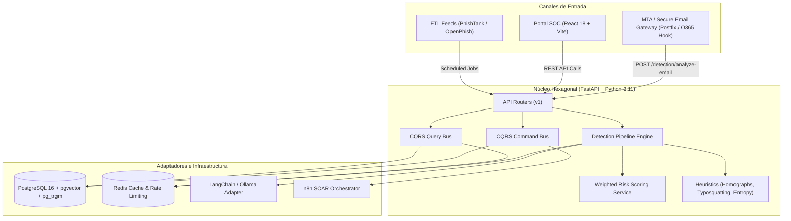

# Documento de Arquitectura: Componentes del Sistema Antiphishing Bancario

## 1. Visión General
El sistema está estructurado bajo los principios de **Arquitectura Hexagonal (Ports & Adapters)** y **CQRS Selectivo**, asegurando desacoplamiento del núcleo de dominio respecto a frameworks (FastAPI, SQLAlchemy, LangChain) e infraestructura de transporte.

## 2. Componentes Principales

## 3. Capas del Sistema
- **Dominio Puro (`app/domain`)**: Sin imports de librerías externas. Contiene entidades de negocio, value objects (RiskScore, Severity, Verdict), eventos de dominio y lógica de cálculo algorítmico (Shannon Entropy, Levenshtein, Punycode).
- **Capa de Aplicación (`app/application`)**: CQRS. Comandos para operaciones mutables (crear incidentes, bloquear IOCs) y consultas para lectura de alta velocidad.
- **Adaptadores (`app/adapters`)**: Repositorios async con SQLAlchemy 2.0, conectores a Redis, clientes LLM (Ollama / Azure OpenAI) y webhooks firmados con HMAC para n8n.
- **Capa de Entrada (`app/api`)**: Routers FastAPI, middlewares de correlación de logs, rate limiting y dependencias de inyección de seguridad.
