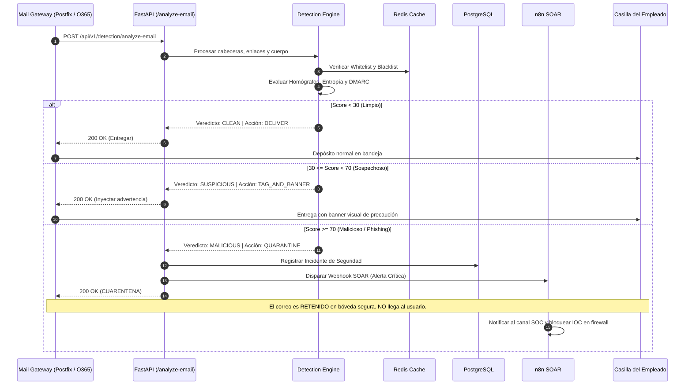

# Flujo de Datos y Pipeline de Inspección en Tiempo Real

## 1. Inspección de Correo en el Perímetro Bancario (Inline Mail Inspection)

En una infraestructura empresarial regulada, la plataforma no espera a que un analista consulte URLs de forma manual. El sistema opera como un **servicio webhook / milter en tiempo real** consumido directamente por el Secure Email Gateway (MTA).

## 2. Bandas de Decisión Operativa
1. **Pase Limpio (Score 0-29)**: El correo superó las pruebas de reputación y alineación criptográfica SPF/DKIM/DMARC. No se genera fricción para el usuario.
2. **Advertencia Preventiva (Score 30-69)**: Remitente externo desconocido o indicadores sutiles de persuasión. El correo se entrega con cabecera `X-Phish-Warning` y un recuadro superior alertando no ingresar credenciales.
3. **Cuarentena Inmediata (Score 70-100)**: Suplantación de identidad confirmada (homógrafo, combosquatting, phishing de token bancario, adjunto malicioso). Se retiene el correo, se crea un ticket SOC con SLA crítico y se orquesta la contención vía n8n.
